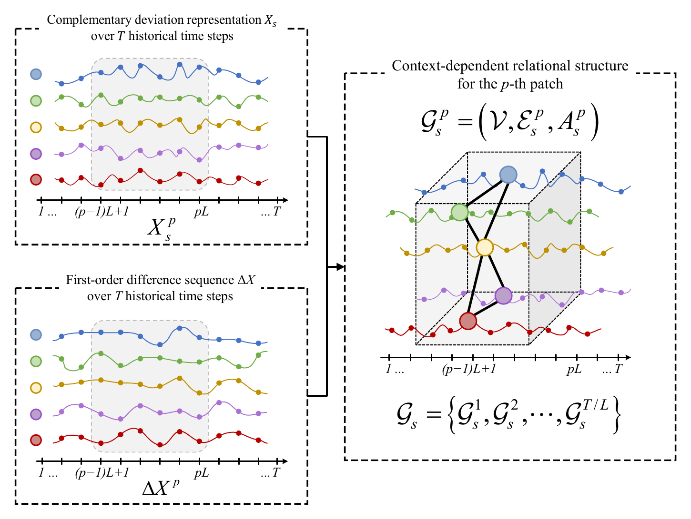
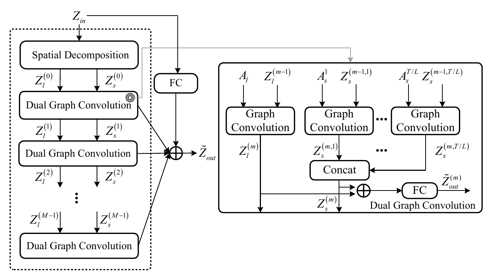

# CARR-SG

**Complementarity-Aware Representation Routing with Shared Graph Guidance for Multivariate Time Series Forecasting**

The manuscript is under review (waiting...) ☀️

This repository contains the PyTorch modules for shared and context-dependent graph construction and Dual Graph Convolution with Spatial Decomposition (DGCSD).

## Shared and Context-dependent Graphs

Some relationships between sensors persist across traffic windows, while others depend on the conditions in a particular window. CARR-SG models them with two graphs.

1. **Shared graph.** The model learns one embedding per sensor during training. It computes similarities between the embeddings and normalizes the resulting edge weights by row. With fixed model parameters, the shared graph stays the same across input windows.
2. **Context-dependent graph.** The model first propagates the preprocessed history over the shared graph, then subtracts the propagated signal from the input to obtain the complementary deviation. It builds the context-dependent graph primarily from that deviation, using first-order temporal differences to modulate the contribution of shared node information.

[](assets/DGCSD.pdf)

[Fig. 2 PDF](assets/DGCSD.pdf) · [Graph construction code](core/graph_learning.py)

## Dual Graph Convolution with Spatial Decomposition

DGCSD takes both graphs and a hidden representation. It decomposes the representation into a shared-graph-propagated component and its complementary residual, then propagates each component over its corresponding graph. It combines the outputs from successive propagation steps with the original hidden representation and projects them for the next layer.

[](assets/context_graph.pdf)

[Fig. 3 PDF](assets/context_graph.pdf) · [Propagation code](core/dgcsd.py)

| Module | Input | Output |
|---|---|---|
| `DualGraphLearner` | Historical inputs `[B, C, N, T]` | Shared graph `[N, N]` and one context-dependent graph per sample `[B, N, N]` |
| `DGCSD` | Hidden features `[B, C_in, N, T]` and both graphs | Updated hidden features `[B, C_out, N, T]` |

`B`, `C`, `N`, and `T` denote the batch size, number of channels, number of nodes, and number of time steps.

## Run the Demo

Run the following commands from the repository root. The default demo uses small synthetic tensors and runs on a CPU.

```bash
python -m pip install -r requirements.txt
python demo.py
```

To run the same modules on real traffic observations, use the included [PEMS04.npz](data/PEMS04.npz).

```bash
python demo.py --pems04 data/PEMS04.npz
```

[The demo](demo.py) reads the first two nonoverlapping 12-step windows, standardizes each sensor within its window, and builds one shared graph and one context-dependent graph per window. It then uses the standardized flow as single-channel node features to illustrate propagation. The script prints the difference between the two context-dependent graphs, intermediate values from both propagation branches, and the DGCSD output shape. A fixed seed sets the randomly initialized parameters. The demo ends at the intermediate features.

## Code Availability

If the paper is accepted, we'll release the full implementation here. If not, we'll sleep on it and head back to the drawing board. 🌙😴

The code is licensed under [Apache-2.0](LICENSE).
