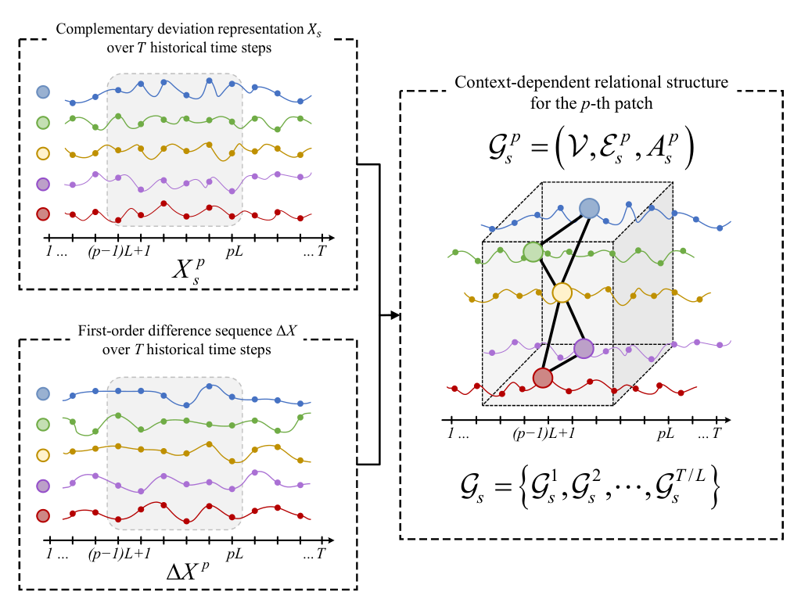
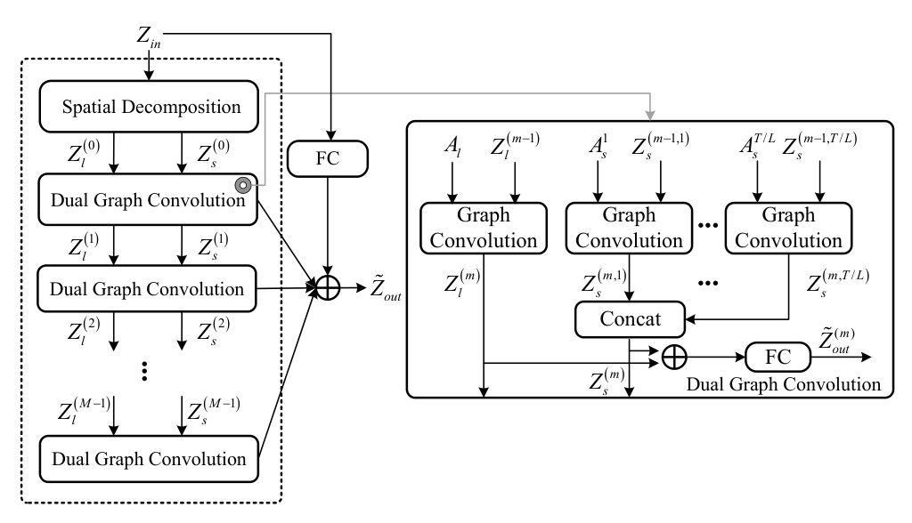

# CARR-SG

**Complementarity-Aware Representation Routing with Shared Graph Guidance for Multivariate Time Series Forecasting**

论文目前正在审稿。本仓库提供 CARR-SG 的 PyTorch 核心代码预览，包含**共享图与上下文图学习**和**双图卷积与空间分解（DGCSD）**。

[模型方法](#模型方法) · [输入与输出](#输入与输出) · [可运行示例](#可运行示例) · [代码可用性](#代码可用性)

## 模型方法

### 共享图与上下文图学习

CARR-SG 从可学习的节点嵌入构建跨预测窗口共享的关系图，并以该图为参照，将历史表示分解为共享图传播分量和互补偏差分量。上下文图以互补偏差为主要构图依据，一阶时间差分调节共享节点信息的贡献。图 2 展示了局部时间片段上上下文关系的构建。



*图 2. 基于局部时间片段构建上下文关系。*

代码对应 [DualGraphLearner](core/graph_learning.py)。

### 双图卷积与空间分解（DGCSD）

如图 3 所示，DGCSD 先用共享图分解输入隐藏表示，得到共享图传播分量和互补偏差分量。随后，前者沿共享图传播，后者沿上下文图传播。模块汇合各传播阶的双路特征，并结合未传播的输入表示生成输出。



*图 3. DGCSD 结构示意，展示隐藏表示分解、双路图传播与多阶特征聚合。*

代码对应 [DGCSD](core/dgcsd.py)，输入为隐藏表示、共享图和上下文图。

## 核心模块

| 文件 | 入口 | 功能 |
|---|---|---|
| [`core/graph_learning.py`](core/graph_learning.py) | `DualGraphLearner` | 从历史表示生成共享图和上下文图。 |
| [`core/dgcsd.py`](core/dgcsd.py) | `DGCSD` | 在隐藏表示上执行空间分解、双路图传播和多阶聚合。 |
| [`demo.py`](demo.py) | `main` | 生成合成输入，串联构图与传播并检查输出。 |

## 输入与输出

`B` 是样本数，`N` 是节点数，`C` 是通道数，最后一维是时间。

| 调用 | 输入 | 输出 |
|---|---|---|
| `learner(history, history_length=12)` | `history [B, C_in, N, T_in]` 是预处理后的主干历史张量，可含左填充。`history_length` 指定末尾实际用于构图的历史长度。 | 共享图 `[N, N]`，上下文图 `[B, N, N]`。 |
| `dgcsd(hidden, shared_graph, context_graph)` | `hidden [B, C_in, N, T_hidden]` 是进入图传播的隐藏表示，另传入上述两张图。 | 传播并聚合后的隐藏表示 `[B, C_out, N, T_hidden]`，供后续层使用。 |

示例中的两次调用如下，输入张量和模块的构造见[完整示例](demo.py)。

```python
shared_graph, context_graph = learner(history, history_length=12)
features = dgcsd(hidden, shared_graph, context_graph)
```

## 可运行示例

示例演示如何把构图模块的输出接到 DGCSD。它用固定随机种子初始化模块，生成 2 个样本、4 个节点、12 步历史，再单独生成形状为 `[2, 8, 4, 7]` 的隐藏表示作为第二个模块的输入。程序检查邻接矩阵的行和以及输出的形状与有限性。完整模型中的这份隐藏表示由前序网络层产生。

在仓库根目录运行以下命令。已在 Python 3.12.4 与 PyTorch 2.9.1+cpu 上验证。

```bash
python -m pip install -r requirements.txt
python demo.py
```

```text
Shared graph: (4, 4)
Context graph: (2, 4, 4)
DGCSD output: (2, 8, 4, 7)
```

## 代码可用性

完整实现，包括训练与评估脚本、实验配置和运行说明，将在论文录用后于本仓库公开。

## 许可与来源

代码沿用 [SDGL-SeqDe](https://github.com/songbaizhu/SDGL-SeqDe) 的 [Apache-2.0](LICENSE) 许可。[来源说明](THIRD_PARTY_NOTICES.md)记录了预览模块与原实现的对应关系。
